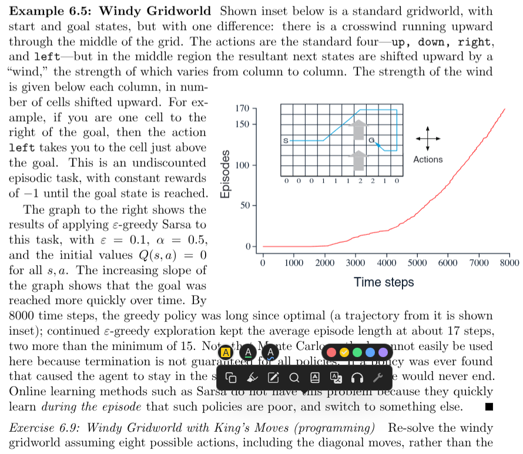
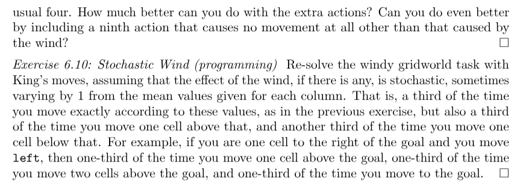
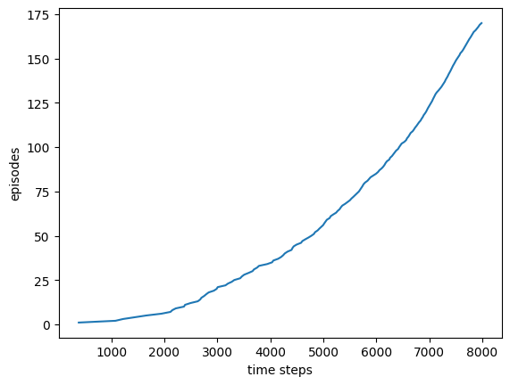
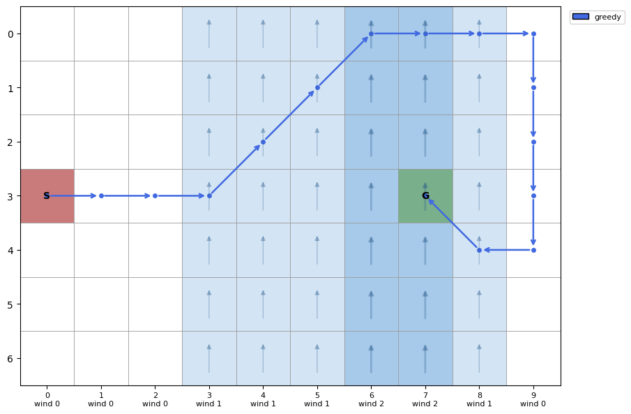
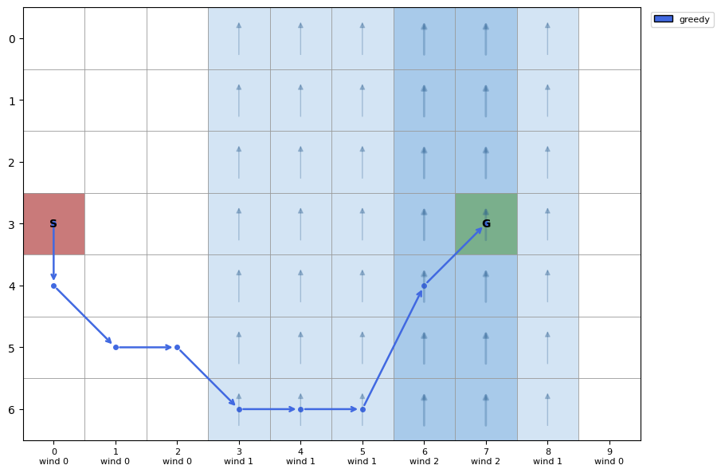
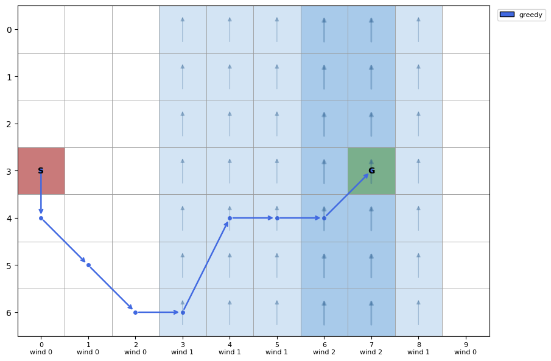

# Reinforcement Learning: An introduction by Sutton & Barto

This is my repository for solving examples by code from the book Sutton and Barto 

## Racetrack problem (Example 5.12 Monte Carlo Methods)

#### Solution: racetrack.ipynb

Firstly we build the racetrack from the book, the idea is to break down the track into 6 rectangles

Here's how to breakdown the first track into the 6 pieces

you can use similar breakdown for the second track and use that in the notebook, just replace the rectangles

I only employ On Policy Monte Carlo (first visit) yet. Would do Off policy soon!

Here's some trajectories with noise = 0.1 injected! I was thinking of increasing noise to make the policy less "hug the wall" solution

## Windy Gridworld problem (Example 6.5 Temporal Difference Learning)

Soo it's a relatively easier gridworld, I use 3 different action modes 4, 8, 9 which represent action_space size. 4 meaning classic up down left right, 8 includes diagonal actions, while 9 also includes a 0,0 action that is stay still.

This graph shows a cool property of TD learning, it explores till around 2000 episodes while no results/termination. Monte Carlo would've failed in such a setting since it needs the final estimate of G, while this is bootstrap of return G. that is, Monte Carlo would require the episode to end to actually have a reward signal while here it uses estimates. 

Then there's policies learnt for different modes

### Actions mode = 4
approximate steps = 15

### Actions mode = 8
approximate steps = 8

### Actions mode = 9
approximate steps = 8

## Cliffwalking Problem